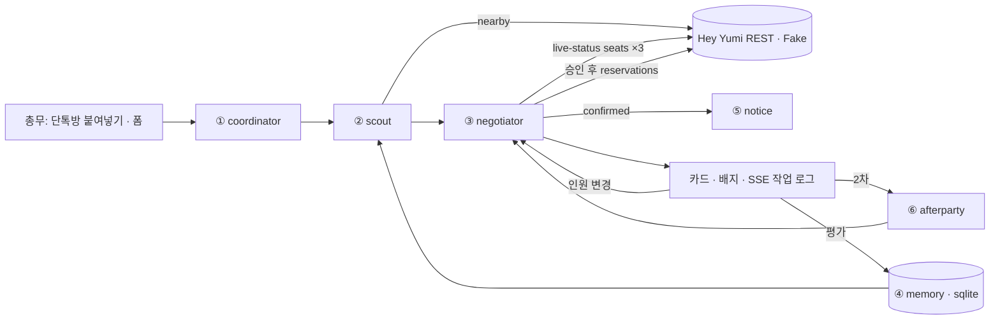

# 밥상외교 — 막내의 회식 비서

회식·팀 점심·거래처 식사를 정하는 총무(주로 막내)를 위한 에이전트 웹앱. 회식 장소가 아니라 회식 하루를 맡는다.
흐름: 단톡방 텍스트 → 조건 정리 → 탐색(모임 기억 반영) → 사장님께 자리 문의(3곳 동시) → 승인 → 예약(거절 시 다음 후보 자동) → 공지문 → 인원 변경 재확인 → 2차 찾기 → 평가를 기억에 저장.
핵심 메시지: "AI는 유명한 가게를 압니다. 밥상외교는 우리 팀이 실제로 만족했던 가게를 압니다."

## 실행
```
python -m venv .venv && source .venv/bin/activate
pip install -r requirements.txt
cp .env.example .env          # 기본 YUMI_MODE=mock (키 없이 전체 흐름 동작)
python -m scripts.seed_demo   # 데모 부서 3개 · 참석자 · 지난 회식 기록
uvicorn app.main:app --reload # http://localhost:8000
pytest -q
```
실제 데이터: `.env`에서 `YUMI_MODE=rest`, `YUMI_API_KEY=hmp_…` → `python -m scripts.probe_yumi`로 응답 저장·필드 확인 → 서버 재시작.

## 절대 규칙
1. 가게 사실(가격·영업시간·메뉴·자리)은 Yumi 응답이나 사장님 답에서만. LLM·템플릿이 지어내지 않는다. 없는 값은 표시하지 않거나 `unknown` 배지.
2. 근거 배지 4종: `data`(응답 필드) / `owner`(사장님 답 + 시각) / `memory`(우리 팀 기록) / `unknown`(확인 필요).
3. 사장님께 가는 요청(자리 문의·예약)은 `YUMI_ACTIONS`로 잠근다. 기본 `simulate` = Yumi로 보내지 않음(rest 모드면 검색만 실제, 문의·예약은 FakeYumi). `sandbox` = 샌드박스 헤더(운영진 확인 후에만). `live` = 실제, `YUMI_LIVE=1`까지 있어야 열림. 이 잠금을 우회하는 코드를 쓰지 말 것. MCP 도구로 문의·예약 호출 금지(샌드박스 없음).
4. live-status는 **'지금' 질문**이다(영업시간 밖이면 blocked=closed_now). 그래서 회식 시간이 90분 이내면 `now_mode`(3곳 동시 자리 문의 → 먼저 '가능' → 승인 → 예약), 그보다 먼 날이면 예약 요청 자체가 사장님 확인이다(1순위부터 순서대로, 거절 시 다음). 2차는 항상 now_mode. topic은 `"12명 입장"`처럼 한국어 토큰.
   live-status 동시 최대 3곳(`MAX_PARALLEL`). 예약은 한 번에 한 곳, 사용자 승인 후에만. 취소·인원변경 API가 없으므로 그 경우 "가게에 직접 요청" 안내.
5. 422는 재시도 금지(문의 미지원 처리), 429는 Retry-After. 전화번호는 메모리에만, 로그엔 `mask()`.
6. 키는 `.env`에만. 백엔드 LLM 키는 `LLM_API_KEY`. 셸에 `ANTHROPIC_API_KEY` export 금지(Claude Code 로그인이 바뀜).
7. Yumi 응답 필드명은 추측 금지. 맞지 않으면 `app/yumi/client.py`의 `normalize_place` / `normalize_status`만 고친다. 근거는 `tests/fixtures/*.json`.
8. 외부 호출은 `app/yumi/client.py`에서만. 에이전트는 `YumiClient` Protocol에만 의존(목/REST 교체 가능).

## 스택
Python 3.11+ · FastAPI · httpx(async) · pydantic v2 · sse-starlette · sqlite3 · pytest / 프론트는 빌드 없는 `web/`(HTML·CSS·vanilla JS), FastAPI가 서빙.

## 구조
```
app/
  main.py            라우트, SSE(/events), 정적 파일
  config.py          .env 설정
  models.py          Constraints, Place, Candidate, Evidence, Reservation, Feedback, 요청 모델
  events.py          EventBus(세션별 작업 로그, 구독 시 히스토리 재전송)
  session.py         Session(상태, 후보, 예약, 백그라운드 태스크) + SESSIONS
  store.py           sqlite: groups, visits
  geo.py             dist_m
  yumi/client.py     YumiClient Protocol, RestYumi, normalize_*, make_client()
  yumi/fake.py       FakeYumi(YUMI_MODE=mock, 지어낸 데모 가게 12곳, 응답 지연·결과 시나리오)
  agents/coordinator.py  ① 텍스트→Constraints (규칙 파서 + 선택적 LLM)
  agents/scout.py        ② 검색→필터→점수 (가중치 상수는 파일 상단)
  agents/negotiator.py   ③ 문의/승인/예약/자동 전환/인원 변경
  agents/memory.py       ④ visits→Profile, memory_weight
  agents/notice.py       ⑤ 확정값만 쓰는 공지문 템플릿
  agents/afterparty.py   ⑥ 1차 근처 400m·지금 영업 중 → 3곳 문의(예약 없음)
web/ index.html style.css app.js
scripts/ seed_demo.py probe_yumi.py
tests/ test_flow.py (FakeYumi로 전체 흐름)
```

## 회식(참석자) 모드 — Readdy 시안 구조
- STEP 01 명단: `meetings`·`participants` 테이블. 참석자마다 공유 링크 `/p/{token}`(로그인 없이 출발역·예산·식단·알레르기·선호 음식·분위기 입력, `web/p.html`).
- STEP 02 조건 정리: `agents/meeting.py aggregate()` — 예산 최솟값·식단(dietary)·알레르기(exclude)는 필수, 음식·분위기·주류·룸은 선호. 충돌(예산 차이, 조용함×술)은 완화 제안 + 같은 검색 풀에서 후보 수 변화 계산(추가 API 호출 없음). 완화는 사용자가 누를 때만.
- STEP 03·04 후보 비교: 점수 = 필수 50 · 이동 균형 30 · 선호 20(선호에 모임 기억 포함). 식단·예산·분위기·주류 충족/미충족/확인 필요 표시. 참석자별 이동 시간: `ODSAY_API_KEY` 있으면 대중교통 길찾기, 없으면 직선거리 추정(화면에 출처 표기). 출발역 좌표: 주요 역 표 → 없으면 `KAKAO_REST_KEY`로 카카오 로컬 검색.
- STEP 05·06 모임 기억 + 블로그 초안(`agents/blog.py`, 기록 사실만, LLM 키 있으면 문장만 다듬음).
- 빠른 모드(단톡방 붙여넣기)는 기존 흐름 그대로 유지.

## 아키텍처

상태: `idle → asking → await_approval → reserving → confirmed`, 실패 시 `exhausted`. 예약 거절 시 `auto_fallback`이면 다음 '가능' 후보로 바로 `reserving`.

## 우리 API
`GET /api/config` · `GET /api/groups` · `GET /api/groups/{id}/memory`
`POST /api/plan` {group_id, text | form} → 세션 뷰
`GET /api/sessions/{id}` · `GET /api/sessions/{id}/events`(SSE: {ev, session})
`POST /api/sessions/{id}/ask` · `/approve` {place_id, phone, auto_fallback} · `/headcount` {guests} · `/afterparty`
`GET /api/sessions/{id}/notice` · `POST /api/feedback`

## Hey Yumi 사실 (실제 응답·도구 스키마로 확인, 2026-10-17)
- 검색 응답: `{resolvedAs, success, data:[...], meta:{total, center, radius}}`. 항목 키: id, name, categoryLabel, location{lat,lng}, address{road,jibun}, price{level,avg,min,max}(avg는 메뉴 평균, 1인 비용 아님), reviewCount, freshnessScore, confidence, possiblyClosed, closureSignal, dataQuality, recommendedFor[], serviceAttributes{group_friendly, private_room, parking, reservable…}, nearestStation{station, walkMin}, distanceM, yumiReservable, reservationChannels, aiSummary, reputation{basis[]}, rating(항상 null — 별점 만들지 말 것). 실제 예시: `tests/fixtures/search_euljiro.json`
- 검색은 `region_name`(역·동·상권, 예 "을지로입구역", 역은 약 800m 반경)으로 바로 가능. `reservation_channel=yumi`는 좁은 지역과 함께만(도시 단위는 거절). 을지로입구역 group_dining 파트너는 10곳 확인.
- seats 문의 topic은 인원이 들어간 짧은 한국어 토큰: "12명 입장". 인원 없는 질문 금지.
- **MCP 도구에는 샌드박스 옵션이 없다.** MCP의 request_live_status/request_reservation은 실제 사장님 알림. 테스트는 우리 백엔드 REST(샌드박스 헤더)로만.
- MCP 도구 15종: search_places, nearby_places, get_place, show_place_photos, resolve_regions, list_categories, get_stats, request_live_status, wait_for_live_status, get_live_status, search_live_status, request_reservation, wait_for_reservation, get_reservation, restaurant_reservation

## Hey Yumi 사실 (문서 확인분)
- REST `https://api.heyyumi.ai/api/v1`, `Authorization: Bearer hmp_…`. MCP `https://mcp.heyyumi.ai/mcp`
- MCP 실제 도구(15): search_places, nearby_places, resolve_regions, get_place, show_place_photos, list_categories, get_stats, request_live_status, wait_for_live_status, search_live_status, get_live_status, request_reservation, wait_for_reservation, get_reservation, restaurant_reservation
- MCP nearby_places 파라미터: lat, lng, radius_m(기본 1000, 최대 5000), sort(distance|discovery), fields(기본 quality), recommended_for, private_room 등 불리언("true"), open_at, reservation_channel(yumi|phone, 반드시 동네·역 등 좁은 범위와 함께), max_dish_price(가장 싼 메뉴 기준, 1인 비용 아님), exclude, atmosphere(순위만), page_size≤100. 평점은 항상 null(지어내지 말 것)
- MCP request_live_status: placeId, kind(item|wait|seats), topic(짧은 토큰, 인원 포함), question(선택). 샌드박스 옵션 없음 = 실제 사장님 푸시. 개발 중에는 MCP로 문의·예약 금지, REST 샌드박스로만
- `GET /places?region_name=` · `GET /places/nearby?lat&lng&radius(≤5000)` · `/places/{id}` · `/regions?dong=` · `/meta`(키 불필요, 한국어 aliases) · `/places/{id}/history`
- 필터: recommended_for(group_dining, business_meeting, formal_gathering, family), 불리언 52종(private_room, parking, group_friendly…), dietary, max_dish_price, open_at(now | 19:00 | 2026-10-17 dinner), reservable, reservation_channel=yumi, min_confidence, exclude, page_size≤100
- 토큰: fields 등급 core1/contact_hours2/quality2/edge4/media8, 요청당 최고 등급만 → `core,quality,edge`=4. Pro 월 30,000·60rpm
- 신뢰: freshnessScore(null=신호 부족), confidence(<0.6 확인 권장), possiblyClosed, closureSignal
- `POST /live-status` {placeId, kind: seats|wait|item, topic:"12명 입장", question?} → `GET /live-status/{queryId}?wait=25`; available|limited|unavailable|soon|not_offered|no_response(~5분), 영업시간 밖 blocked=closed_now, 최근 답 reused=true
- `POST /reservations` {placeId, reservationTime(+09:00), guestCount, guestPhone, idempotencyKey, guestName?, note?} → `GET /reservations/{id}?wait=25`; confirmed|cancelled|expired|no_show
- 샌드박스 `X-Map3-Sandbox: 1` → 약 8초 뒤 결과, `sandboxOutcome`으로 결과 지정(코드는 바디에 넣음 — 위치는 https://heyyumi.ai/developers/api-reference 로 확인)
- 예약·문의는 파트너 매장만(아니면 422). 웹훅 없음.

## 다음 작업 후보 (우선순위)
1. `YUMI_MODE=rest` 샌드박스로 전체 흐름 확인(REST 경로 `/places`의 region_name 지원, live-status·reservations 응답 키는 probe로 재확인)
2. 파트너 매장이 적으면 scout의 반경·relax 단계 조정
3. LLM_API_KEY 연결 시 coordinator 결과 확인(실패 시 규칙 파서 유지)
4. 카카오 공유하기(공지문 → 단톡방), McpYumi(같은 Protocol을 MCP 클라이언트로)

## 코드 스타일
타입 힌트, 작은 함수, 쓰지 않는 추상화 금지, 주석은 '왜'만. UI 문구는 짧은 존댓말, 과장 금지("완벽한·최고의·✨AI" 금지), 그라데이션·글래스모피즘 금지. 변경 후 `pytest -q`.

## 화면 (2026-10-17 교체)
- `/` = Readdy 시안을 옮긴 새 화면(web/index.html + app.js), `/classic` = 이전 화면
- 스타일은 web/tw.css(Tailwind 3.4 빌드 결과) + web/bapsang.css(시안 색·글꼴 변수). CDN 런타임 없음
- app.js에 새 Tailwind 클래스를 쓰면 tw.css를 다시 빌드: `npm install && npm run build:css` (tailwind.config.js)
- 개발자 모드(푸터) = 실매장 테스트: /api/lab/lookup?q= (읽기 전용 검색), /api/lab/session (가게 1곳, 자동 넘김 없음, DEMO_SCRIPT 순서 안 씀)
- 하이드미플리즈 을지로 테스트 절차: docs/LIVE_TEST.md
