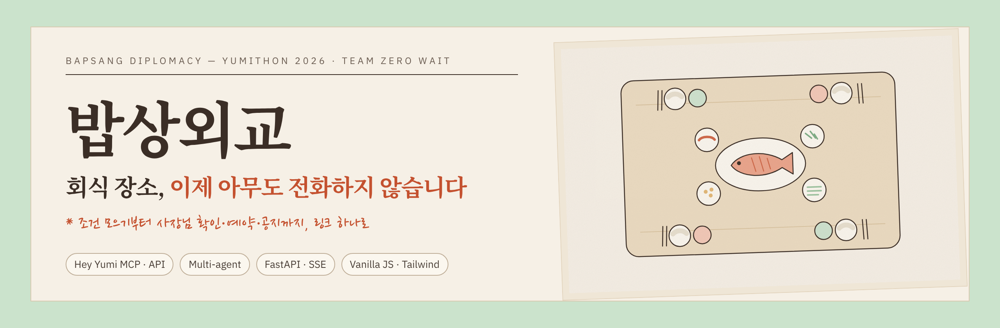
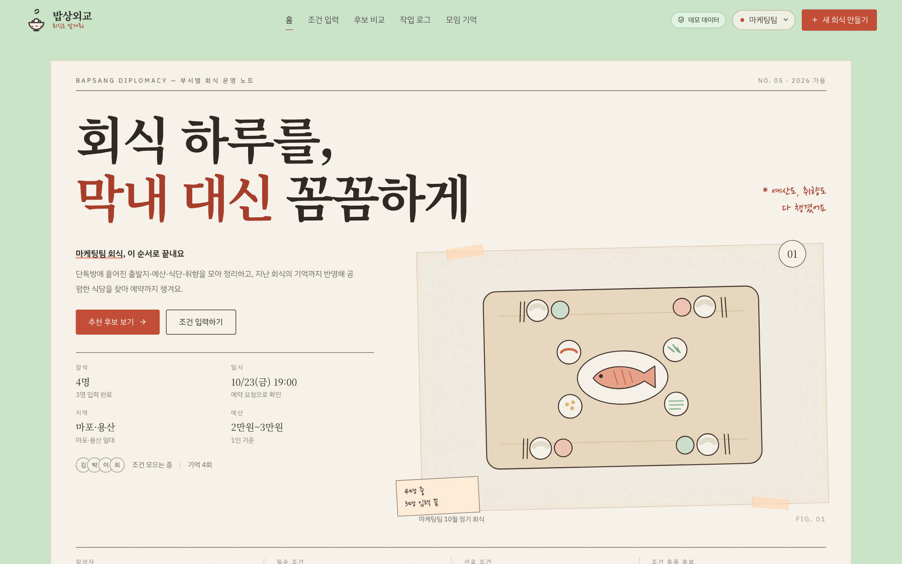
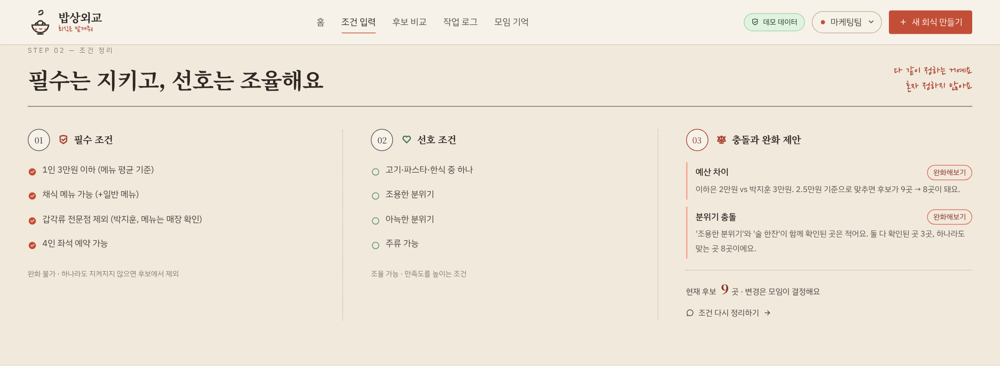
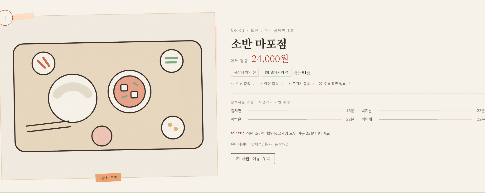
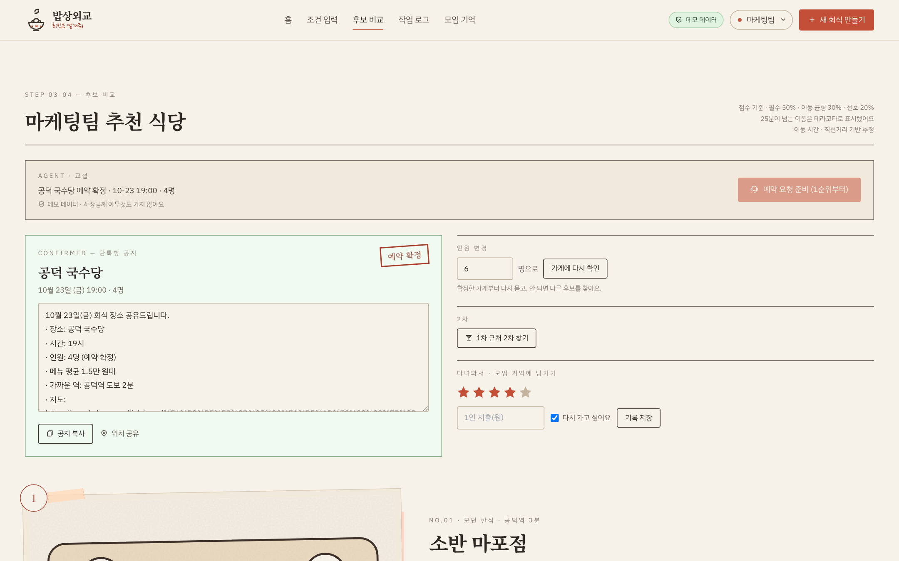
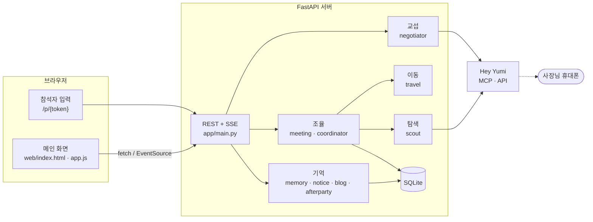
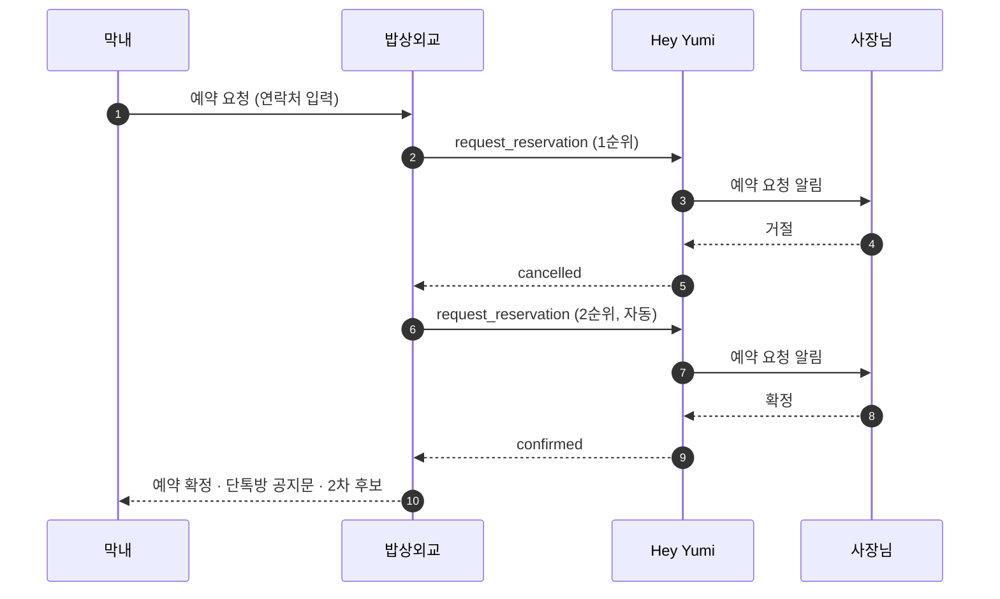

<p align="center">
  
</p>

<p align="center">
  <a href="https://youtu.be/qfU2DYgPS1E"></a>
  
  
  
  <a href="../../actions/workflows/ci.yml"></a>
  
</p>

<p align="center">
  <b>팀원 조건 모으기 → 후보 찾기 → 사장님 확인 → 예약 → 공지 → 팀 기억</b><br>
  회식 장소를 정하는 하루를 통째로 맡는 에이전트 웹앱
</p>

---

## 왜 만들었나

회식 날짜가 잡히면 장소는 보통 막내가 정합니다. 채식하는 사람, 갑각류를 못 먹는 사람, 생각하는 예산도 퇴근길도 다 다릅니다. 단톡방에서 조건을 하나씩 받고, 지도 앱을 뒤지고, 마지막엔 가게마다 전화를 겁니다. **어디가 좋은지는 금방 찾아도, 오늘 열 명 자리가 있는지는 결국 전화해 봐야 압니다.**

밥상외교는 그 마지막 전화를 없앱니다. [Hey Yumi](https://heyyumi.ai)가 AI용으로 정리한 매장 데이터와 **사장님께 직접 자리를 묻고 예약을 요청하는 통로**를 써서, 여러 사람의 조건을 맞추는 일부터 예약 확정까지 이어서 처리합니다.

> YUMITHON 2026 (Hey Yumi × 하이드미플리즈 을지로) 출품작 · **Team ZERO WAIT**

<p align="center">
  <a href="https://youtu.be/qfU2DYgPS1E">
    
  </a>
  <br><sub>▲ 클릭하면 60초 데모 영상이 열립니다 · 마지막 장면은 하이드미플리즈 을지로에 보낸 실제 자리 문의</sub>
</p>

---

## 한눈에 보기

<table>
<tr>
<td width="50%"></td>
<td width="50%"></td>
</tr>
<tr>
<td><b>부서별 회식 노트</b><br>팀마다 회식을 따로 만들고, 참석 인원·일시·지역·예산 범위를 한 장에서 봅니다.</td>
<td><b>필수는 지키고, 선호는 조율</b><br>꼭 지켜야 할 조건과 맞춰 볼 조건을 나누고, 부딪히는 곳은 "이렇게 풀면 후보가 몇 곳 늘어난다"를 보여 줍니다.</td>
</tr>
<tr>
<td></td>
<td></td>
</tr>
<tr>
<td><b>모두가 오기 좋은 순서</b><br>참석자별 이동 시간, 조건 충족 여부, 추천 이유, 메뉴 평균 가격을 카드 하나에.</td>
<td><b>거절되면 다음 가게로 자동</b><br>확정되면 단톡방 공지문, 인원 변경 재확인, 1차 근처 2차 찾기까지 이어집니다.</td>
</tr>
</table>

---

## 기능

| 단계 | 하는 일 | 화면 |
|---|---|---|
| **01 명단** | 참석자마다 로그인 없는 개인 링크 발급 · 단톡방용 링크 묶음 복사 · 출발역/예산/식단/알레르기/취향 입력 | [참석자 표](docs/images/03_participants.png) · [모바일 입력](docs/images/04_participant_mobile.png) |
| **02 조건 정리** | 필수(예산·식단·알레르기)와 선호(분위기·음식·이동)를 나눔 · 충돌 감지와 완화 제안(후보 수 변화 미리 계산) | [조건 정리](docs/images/05_conditions.png) |
| **03 후보 찾기** | Hey Yumi에서 지역·조건으로 검색 → 폐업 의심·예산 초과·알레르기 제외 → 점수(필수 50 · 이동 균형 30 · 선호 20) | [후보 카드](docs/images/06_candidate.png) |
| **04 확인·예약** | 90분 안이면 사장님께 **실시간 자리 문의**(최대 3곳 동시), 그보다 먼 날은 **예약 요청**으로 확인 · 거절 시 다음 순위로 자동 재요청 | [예약 확정](docs/images/08_confirmed.png) |
| **상세** | 사진·메뉴·주소 · 카카오맵/네이버지도 · 위치 공유 | [가게 상세](docs/images/07_detail.png) |
| **확정 이후** | 단톡방 공지문 · 인원 변경 시 같은 가게부터 재확인 · 1차 근처 2차 찾기 | |
| **05·06 모임 기억** | 만족도·1인 지출·재방문 의사 기록 → 만족했던 가격대는 다음 추천에 반영, 다시 안 갈 곳은 제외 · 후기 블로그 초안 | [모임 기억](docs/images/09_memory.png) |
| **작업 로그** | 조율·탐색·이동·교섭·기억 에이전트가 한 일을 실시간(SSE)으로 한 줄씩 | [작업 로그](docs/images/10_log.png) |
| **실매장 테스트** | 가게 하나만 골라 실제 문의·예약을 끝까지 확인(자동 넘김 없음) · 서버를 켠 컴퓨터에서만 동작 | [절차](docs/LIVE_TEST.md) |

---

## Hey Yumi를 어떻게 썼나

Hey Yumi MCP의 15개 도구 중 **8개**를 서비스 흐름에 맞춰 이어 붙였습니다. 개발할 때는 Claude Code에 Hey Yumi MCP를 연결해 실제 응답 구조를 먼저 확인했고, 서비스 안에서는 같은 도구를 Hey Yumi API로 직접 호출합니다.

| 서비스 단계 | MCP 도구 | 이 프로젝트에서 |
|---|---|---|
| 지역 이해 | `resolve_regions` | "마포·용산", "공덕" 같은 이름을 좌표로 (`RestYumi.region`) |
| 후보 검색 | `search_places` | 참석자 조건을 그대로 필터로: 식단 → `dietary`, 알레르기 → `exclude`, 분위기 → `atmosphere`, 회식 시간 → `open_at` |
| 주변 검색 | `nearby_places` | 지역 이름이 안 맞을 때 좌표 반경 검색으로 대체 |
| 이름 검색 | `search_places(keyword)` | "Hide Me Please Euljiro"처럼 영문 이름으로 실매장 찾기 |
| 상세 | `get_place` | 사진·메뉴·영업시간·주소 (열 때만 호출하고 캐시) |
| 지금 자리 문의 | `request_live_status` → `wait_for_live_status` | 90분 안의 모임, 최대 3곳 동시, 먼저 "가능"이라 답한 곳부터 |
| 예약 | `request_reservation` → `wait_for_reservation` | 승인 후 1곳씩, 거절되면 다음 순위로 자동 |

Hey Yumi가 아니었다면 어려웠던 것:

- **"전화해 보세요"에서 끝나지 않음.** 사장님 휴대폰으로 가는 문의·예약 통로가 있어서, 확인 단계까지 자동화할 수 있었습니다.
- **조건이 곧 필터.** 채식 혼합 가능, 룸, 단체석 같은 속성이 이미 정리되어 있어 크롤링이나 추측 없이 참석자 조건을 그대로 검색에 썼습니다.
- **틀린 추천 방지.** 폐업 의심 신호와 최신성 값으로 문 닫은 가게를 처음부터 걸러 냅니다.

자세한 내용은 [docs/HEYYUMI.md](docs/HEYYUMI.md)에 있습니다.

---

## 구조



예약 흐름 (날짜가 남은 회식):



- 에이전트는 `YumiClient` 인터페이스에만 의존합니다. 데모 데이터(`FakeYumi`), 실제 API(`RestYumi`), 검색만 실제인 하이브리드를 설정 하나로 바꿉니다.
- 진행 상황은 이벤트 버스 → SSE로 화면에 바로 흘러갑니다. 화면을 새로 고칠 필요가 없습니다.
- 자세한 설계는 [docs/ARCHITECTURE.md](docs/ARCHITECTURE.md), 엔드포인트는 [docs/API.md](docs/API.md)를 보세요.

---

## 안전장치

사장님 휴대폰으로 실제 알림이 가는 서비스라, 실수로 보내지 않는 것을 기능만큼 중요하게 다뤘습니다.

- **기본은 시뮬레이션.** `YUMI_ACTIONS=simulate`면 문의·예약은 Hey Yumi로 나가지 않습니다. 실제로 보내려면 `YUMI_ACTIONS=live`와 `YUMI_LIVE=1` 두 개가 모두 필요합니다.
- **가게 단위 허용 목록.** `YUMI_LIVE_PLACES`에 적은 가게만 실제로 보내고 나머지는 전부 시뮬레이션합니다. 데모 때는 하이드미플리즈 을지로 한 곳만 열었습니다.
- **외부 접속 차단.** 공개 주소(터널)로 들어온 요청은 실제 요청이 나갈 수 있는 동작을 할 수 없습니다(403). 서버를 켠 컴퓨터에서만 가능합니다.
- **연락처 비저장.** 예약 연락처는 메모리에만 두고, 로그에는 `010-****-5678`처럼 가립니다.
- **지어내지 않기.** 가격·메뉴·자리 같은 가게 사실은 Hey Yumi 응답이나 사장님 답에서만 가져옵니다. 메뉴 가격은 1인 금액이 아니어서 화면에 "메뉴 평균"으로 표시합니다.

---

## 실행

Python 3.11 이상이면 됩니다. 기본 설정은 키 없이 데모 데이터로 전체 흐름이 돌아갑니다.

```bash
git clone https://github.com/SJY8179/babsang-diplomacy.git
cd babsang-diplomacy
python -m venv .venv && source .venv/bin/activate
pip install -r requirements.txt
cp .env.example .env
python -m scripts.seed_demo          # 데모 부서 3개 · 참석자 · 지난 회식 기록
uvicorn app.main:app --reload        # http://localhost:8000
```

실제 Hey Yumi 데이터로 보려면 `.env`에서 두 줄만 바꿉니다. 문의·예약은 계속 시뮬레이션입니다.

```dotenv
YUMI_MODE=rest
YUMI_API_KEY=hmp_발급받은_키
```

| 설정 | 값 | 설명 |
|---|---|---|
| `YUMI_MODE` | `mock` / `rest` | 데모 데이터 / 실제 Hey Yumi |
| `YUMI_ACTIONS` | `simulate` / `sandbox` / `live` | 문의·예약을 보낼지 |
| `YUMI_LIVE` | `0` / `1` | `live`의 두 번째 잠금 |
| `YUMI_LIVE_PLACES` | placeId 목록 | 실제로 보낼 가게만 |
| `DEMO_SCRIPT` | `0` / `1` | 시연용 시나리오(1순위 거절 → 2순위 확정) |
| `ODSAY_API_KEY` | 선택 | 실제 대중교통 소요 시간 (없으면 직선거리 추정으로 표시) |
| `KAKAO_REST_KEY` | 선택 | 표에 없는 출발지를 좌표로 |
| `LLM_API_KEY` | 선택 | 후기 초안 문장 다듬기 (없으면 기록 기반 템플릿) |

테스트:

```bash
pytest -q        # 14 passed — Hey Yumi를 호출하지 않습니다
```

---

## 폴더 구조

```text
babsang-diplomacy/
├─ app/
│  ├─ main.py            # FastAPI 엔드포인트 · SSE · 실매장 테스트 · 외부 접속 차단
│  ├─ agents/
│  │  ├─ meeting.py      # 참석자 조건 → 필수/선호/충돌 → 검색 → 점수
│  │  ├─ coordinator.py  # 단톡방 텍스트 해석 (규칙 기반 + 선택적 LLM)
│  │  ├─ scout.py        # 후보 탐색 · 근거 배지
│  │  ├─ travel.py       # 참석자별 이동 시간 (ODsay 또는 추정)
│  │  ├─ negotiator.py   # 자리 문의 · 예약 · 자동 다음 순위 · 인원 변경
│  │  ├─ memory.py       # 팀 회식 기억 → 다음 추천 가중치
│  │  ├─ notice.py · afterparty.py · blog.py
│  ├─ yumi/
│  │  ├─ client.py       # Hey Yumi 클라이언트 · 응답 정규화 · 실제 요청 잠금
│  │  └─ fake.py         # 데모 데이터 (Readdy 시안의 가게·인물)
│  ├─ store.py           # SQLite (부서 · 회식 · 참석자 · 방문 기록)
│  └─ session.py · events.py · models.py · config.py
├─ web/                  # 빌드 없는 HTML · vanilla JS · Tailwind 빌드 결과(tw.css)
├─ scripts/              # 데모 데이터 시드 · Hey Yumi 응답 확인
├─ tests/                # 흐름 · 정규화 · 실제 요청 차단 테스트
└─ docs/                 # 설계 · Hey Yumi 연동 · API · 실매장 테스트 · 발표 자료
```

---

## 기술 스택

**Backend** Python 3.11 · FastAPI · httpx(async) · pydantic v2 · sse-starlette · SQLite
**Frontend** HTML · vanilla JS · Tailwind CSS 3(빌드 결과만 포함) · Readdy 시안 기반 디자인
**연동** Hey Yumi MCP / API · ODsay(선택) · Kakao Local(선택) · Claude API(선택)
**품질** pytest · GitHub Actions

---

## 만들면서 배운 것

- 회식은 "맛있는 곳"보다 **"모두가 괜찮은 곳"**을 찾는 문제였습니다. 그래서 한 사람의 취향 점수가 아니라 필수 조건, 이동 균형, 선호를 나눠 점수를 매겼습니다.
- 실시간 문의는 **'지금 자리'를 묻는 기능**이었습니다. 처음엔 모든 회식에 쓰려다가, 날짜가 남은 회식은 예약 요청 자체를 확인 수단으로 쓰도록 흐름을 바꿨습니다.
- 실제 데이터에서는 필터를 겹겹이 걸면 후보가 거의 남지 않았습니다. 후보가 적으면 필터를 풀어 다시 찾고, 대신 카드에 "확인 필요"를 정직하게 표시하도록 바꿨습니다.

## 다음 단계

- 카카오톡 공유로 단톡방에서 바로 참여
- 1/N 정산과 영수증으로 지출 기록
- 실제 대중교통 소요 시간 기본 적용

---

## 팀

**Team ZERO WAIT** · 양승준 · 김지은

- 발표 자료: [docs/presentation/babsang_yumithon.pdf](docs/presentation/babsang_yumithon.pdf) · [발표 대본](docs/PRESENTATION.md)
- 디자인 시안: Readdy로 만든 시안을 바탕으로 직접 구현했습니다. 일러스트는 이 저장소에 포함된 SVG입니다.

<sub>가게 이름이 나오는 데모 데이터(마포 일대 10곳, 지난 회식 기록, 인물)는 시연용으로 지어낸 것입니다. 실제 가게 정보는 `YUMI_MODE=rest`일 때 Hey Yumi에서 가져옵니다.</sub>

## License

[MIT](LICENSE)
