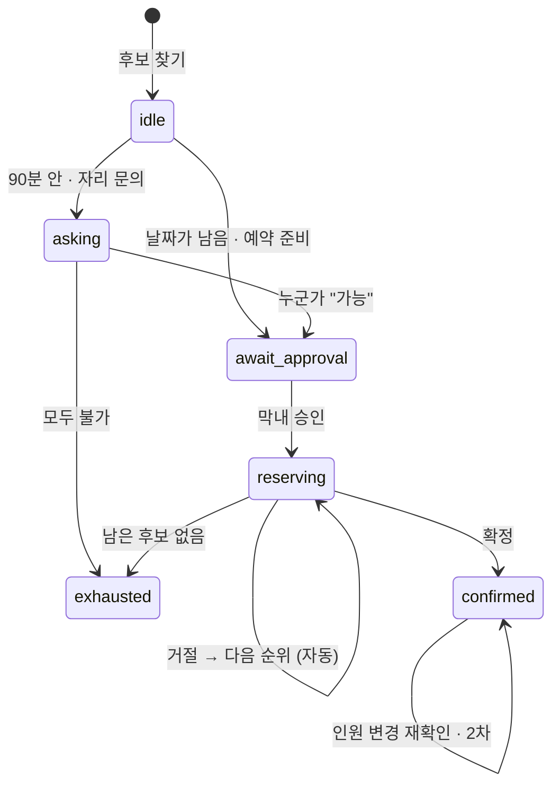

# 설계

## 에이전트

밥상외교는 한 번의 LLM 호출로 답을 만드는 구조가 아니라, 역할이 나뉜 에이전트가 이벤트 버스로 진행 상황을 남기며 순서대로 일합니다. LLM은 선택 사항이고, 없어도 전체 흐름이 동작합니다.

| 에이전트 | 파일 | 하는 일 |
|---|---|---|
| 조율 | `agents/meeting.py` · `coordinator.py` | 참석자 조건 → 필수/선호/충돌, 지역 결정(지정 지역 또는 출발지 가운데), 완화했을 때 후보 수 미리 계산 |
| 탐색 | `agents/scout.py` · `meeting.py` | Hey Yumi 검색 → 제외 규칙 → 근거 배지(데이터 · 사장님 · 기억 · 확인 필요) |
| 이동 | `agents/travel.py` | 참석자별 소요 시간. ODsay 키가 있으면 실제 대중교통, 없으면 직선거리 × 1.3 ÷ 20km/h + 8분 |
| 교섭 | `agents/negotiator.py` | 자리 문의(동시 3곳) · 예약(1곳씩) · 거절 시 다음 순위 · 인원 변경 재확인 |
| 기억 | `agents/memory.py` | 방문 기록 → 만족 가격대 · 좋았던 조건 · 다시 안 갈 곳 → 다음 추천 가중치 |
| 마무리 | `notice.py` · `afterparty.py` · `blog.py` | 단톡방 공지 · 2차 찾기 · 후기 초안 |

## 점수

```
종합 = 필수 충족 50% + 이동 균형 30% + 선호 20%
```

- **필수**: 예산, 식단, 알레르기 제외. 하나라도 어기면 후보에서 빠집니다.
- **이동 균형**: 가장 오래 걸리는 사람 기준. 25분이 넘으면 화면에 테라코타색으로 표시합니다.
- **선호**: 분위기, 음식 종류, 주류, 팀 기억(좋았던 가격대 · 조건).

## 상태와 흐름



- 세션은 메모리(`app/session.py`), 부서·회식·참석자·방문 기록은 SQLite(`app/store.py`)에 둡니다.
- 에이전트는 `EventBus`에 한 줄씩 남기고, `/api/sessions/{sid}/events`가 SSE로 화면에 보냅니다. 화면은 이벤트마다 세션 전체를 받아 다시 그립니다.

## 프론트엔드

- 빌드 도구 없이 FastAPI가 `web/`을 그대로 서빙합니다.
- Readdy로 만든 시안의 색(oklch 변수)·글꼴·레이아웃을 옮기고, 시안의 데모 데이터를 실제 API와 연결했습니다.
- Tailwind는 빌드 결과(`web/tw.css`)만 저장소에 둡니다. 클래스를 추가했다면 `npm install && npm run build:css`.
- 사용자 입력은 모두 이스케이프해서 그립니다(테스트로 스크립트 주입을 확인).
